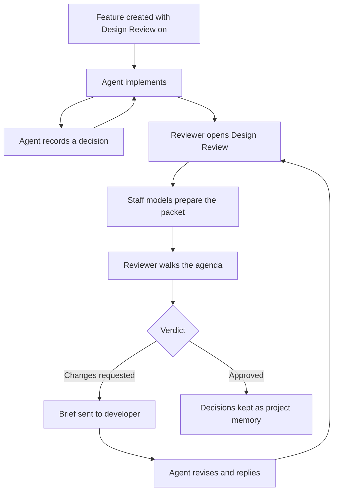
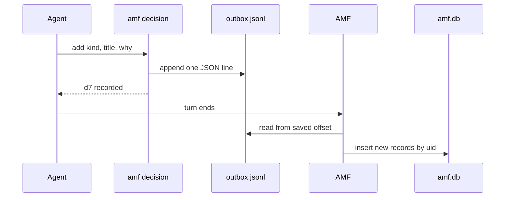
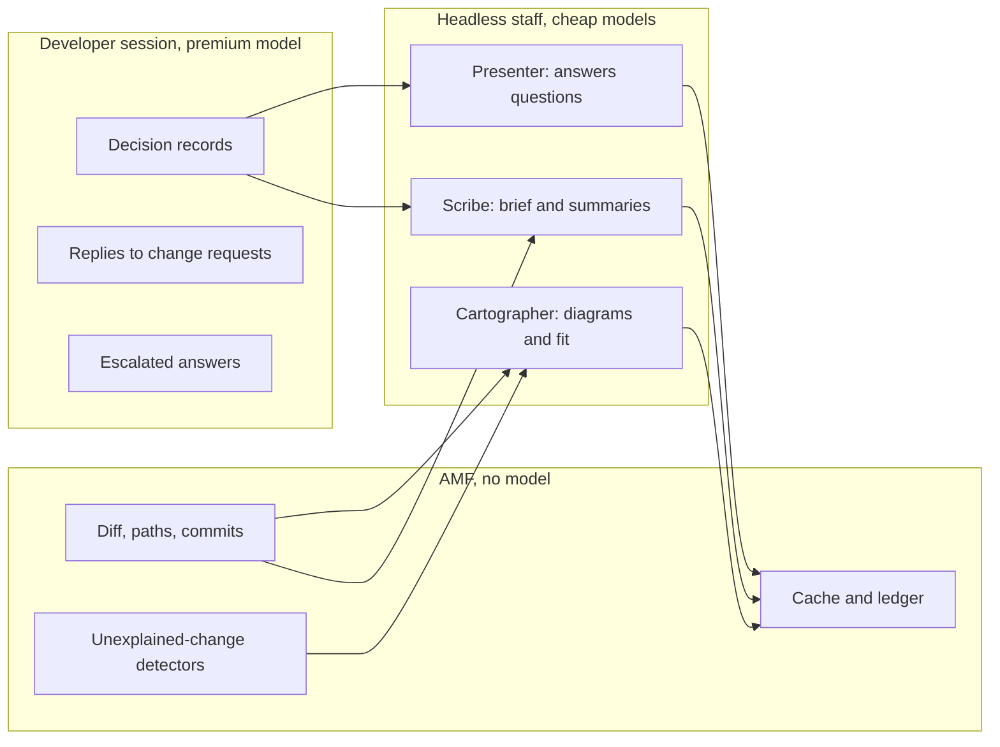
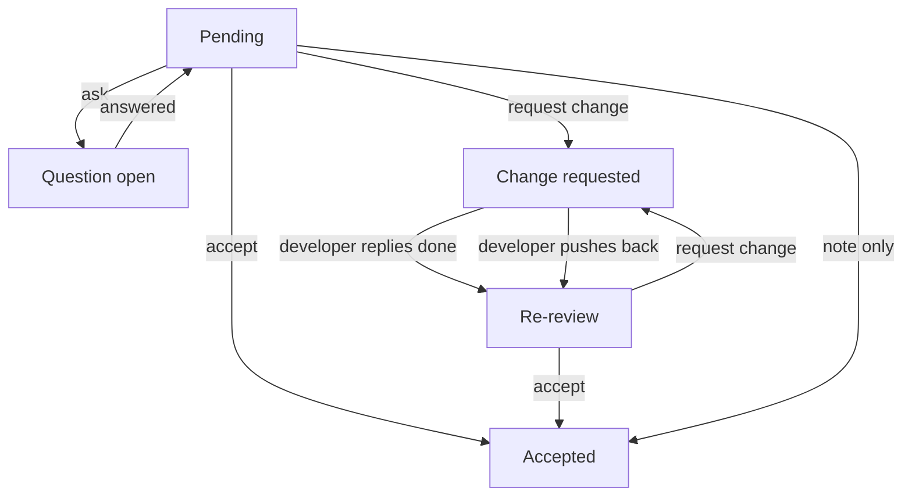
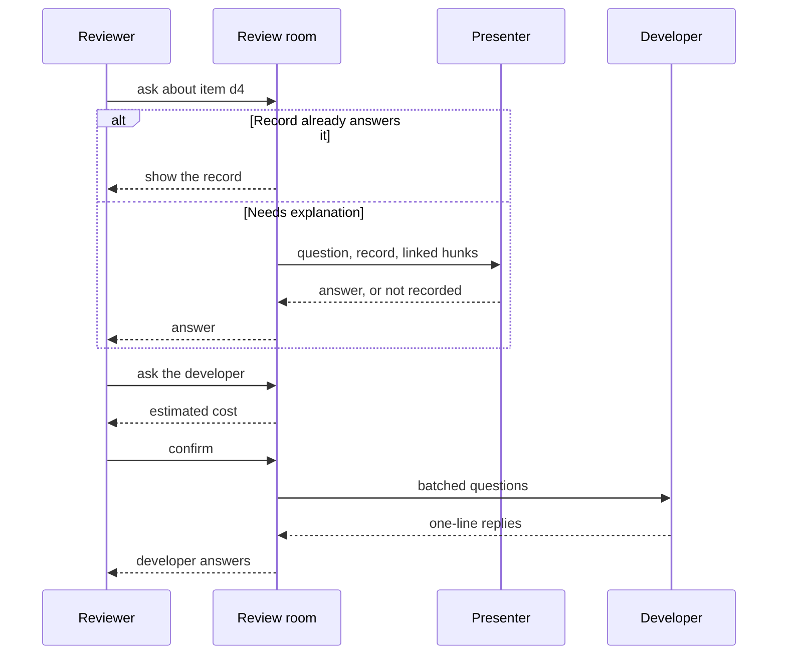
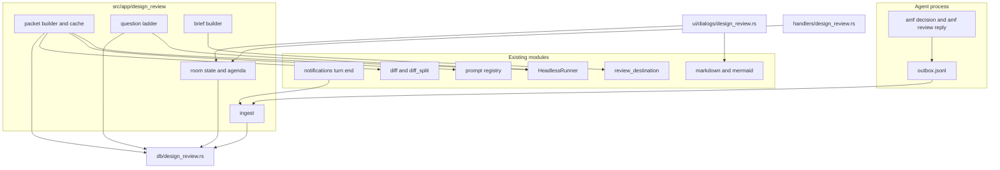

# Design Review: the developer explains their work

- **Status:** Designing
- **Owner:** unassigned
- **Relates to:** Review Mode and Final Review (`src/app/review/`),
  review questions (`src/app/review_questions/`),
  [the review-notes cost investigation](../final-review-subagent-notes-investigation.md),
  [token-efficient sessions](token-efficiency-plan.md) §7,
  [Learning Mode](learning-mode-plan.md),
  [Mermaid support](mermaid-support-plan.md),
  [headless prompts](../development/features/headless-prompts.md)

A new mode, built from scratch, with two halves:

1. **Decision Log.** While it works, the agent records the choices a teammate
   would question: architecture, data model, dependencies, trade-offs,
   deviations from the plan, known risks.
1. **Design Review.** When the feature is done, the reviewer sits down with
   the work the way a team does in an in-person review. The developer's
   decisions, generated architecture diagrams and the change itself are laid
   out as an agenda. The reviewer accepts items, asks questions and requests
   changes, and the developer refines the work until the review is approved.

The hard requirement is token efficiency. The premium model that writes the
code pays only for what it alone knows (the "why"), in a write-only form.
Everything else is derived by cheaper models in separate, small contexts.

**Scope for now: Claude Code only.** The first version is offered only on
features whose agent is Claude Code, and the UI says so wherever the mode can
be switched on or opened. See [Harness scope](#harness-scope).

## Why / problem

Final Review is a line-level diff review. It answers "is this code right?"
but not "why is it built this way, and does it fit the project?". The only
design signal it has is Review Mode's `.claude/review-notes.md`: one or two
sentences per changed file. That is the wrong unit. A design decision spans
files, and most files carry no decision at all.

Review Mode's notes loop was also the token problem this plan must not
repeat. The investigation estimated 150–250K cost-equivalent input tokens on
a large branch, dominated by the agent re-reading a growing file each batch
and that content then riding in context for the rest of the session. The
blind-append fix removed the read. The per-file write tax remains, and it
still buys per-file notes rather than design rationale.

## Audit of what exists

Audited against the tree at `49d9b0c6` (v0.52.0).

### Findings that shape the design

- **Review Mode reaches Claude only.** `ensure_review_claude_md`
  (`src/app/setup.rs:1785`) takes no harness and always writes
  `CLAUDE.local.md`. `ensure_plan_mode_instructions` (`setup.rs:1674`) is the
  harness-aware pattern: `CLAUDE.local.md` for Claude, `AGENTS.md` otherwise.
- **Final Review state is file-centric.** `DiffViewerState`
  (`src/app/review/state.rs:561`) holds about a hundred fields keyed by path:
  verdicts, line comments, notes, overlays. It has no notion of a decision or
  an agenda.
- **Review questions are not persisted.** The `Q` overlay
  (`src/app/review_questions/`) keeps turns in memory and loses them when the
  overlay closes. It has no way to ask the developer.
- **Review-time AI output is not cached.** The walkthrough and the changeset
  overview live in `DiffViewerState` and are regenerated on every open. The
  walkthrough runs through `ClaudeLauncher`, so it is Claude-only.
- **AMF exposes no MCP server to agents.** The agent-to-AMF channels are the
  `amf` CLI and hook scripts over the IPC socket. `amf set-status`
  (`src/cli.rs:677`) is the precedent for an agent-callable, hidden
  subcommand that records data.
- **Agent sessions already carry identity.** `AMF_FEATURE_SESSION_ID` and
  `AMF_SESSION` are in the session environment (`src/hook_payload.rs:25`), so
  a CLI call can be attributed without the agent passing anything.
- **Edited file paths do not reach AMF** outside Vibeless. `PostToolUse`
  sends no path (`setup.rs:1598`). Linking a decision to code has to come
  from git, not hooks.
- **There is no cheap-model tier at runtime.** `review_model` and
  `review_models` (`src/app/mod.rs:557`) select a model per `ReviewAction`
  and default to unset. Learning answers and session summaries pass no model.
- **The TUI renders Mermaid, within limits.** `src/mermaid.rs` supports
  `flowchart`/`graph` and `sequenceDiagram` only: 32 nodes, 64 edges, 8
  groups, 8 participants, 64 events, 120-character single-line labels. The
  GUI does not render Mermaid at all.
- **Turn end is already a hook point.**
  `archive_review_notes_after_agent_turn` (`src/app/notifications.rs:483`)
  runs on `stop`, `thinking-stop` and `input-request`.
- **Pricing is one global rate, not per model.** `TokenPricingConfig`
  (`src/token_tracking.rs:833`) holds a single set of rates defaulting to
  Sonnet 4.x. Subagents are priced as their parent, and Codex cached input
  is charged twice. Filed as #863.
- **Usage exists per session and per headless run, not per task.**
  `SessionTokenUsage` is a session's cumulative total, read from the
  transcript, with subagent transcripts already summed in. `HeadlessUsage`
  reports one run, each counter optional.
- **Haiku costs five times more above 100K prompt tokens** (`CLAUDE.md`
  model table). Staff prompts must stay under that line.

### Reuse or build new

Reuse only where the fit is exact.

| Existing piece | Verdict | Reason |
| --- | --- | --- |
| `diff::load_snapshot`, `DiffFile`, base-ref resolution | Reuse | Exact fit for "what changed" |
| `diff_split::pack_file_sections` | Reuse | Budgeted packing of an oversized diff |
| `HeadlessRunner::run`, `run_read_only`, `run_with_progress` | Reuse | Harness-neutral, leased, reports usage |
| Prompt registry and overrides (`src/prompts/`) | Reuse | New `PromptId`s; users can edit them |
| `markdown` + `DiagramDocument` rendering | Reuse | Renders packet text and diagrams |
| `review_destination` picker | Reuse | "Where do fixes go" is the same question |
| Turn-end hook point in `notifications.rs` | Reuse | Ingest trigger |
| `ensure_plan_mode_instructions` | Pattern only | Copy its harness-aware shape |
| `SessionContextSnapshot` | Reuse | Prices an escalation before it is sent |
| `SessionTokenTracker`, `HeadlessUsage` | Reuse | The two sources of measured usage |
| Token count and dollar formatters | Reuse | Same look as the sidebar |
| `cost_usd`, `cost_equivalent_tokens`, session totals | Build new | One global rate and double-counting (#863); the definition of "effective" is kept |
| `TokenPricingConfig` | Fallback only | One global rate; a per-model table is built new |
| Claude transcript parser | Pattern only | It keeps one running total; the ledger needs entries with model and time |
| `DiffViewerState` and the diff viewer | Link, do not extend | File-centric; open it from an agenda item instead |
| `review-notes.md`, archive, `ensure_review_claude_md` | Build new | Per-file unit, Claude-only, file the agent can read |
| `review_questions` | Build new | In-memory, diff-anchored, no escalation |
| `final-review-feedback.md` and `**Agent:**` replies | Build new | Makes the agent read and edit a growing file |
| Walkthrough, changeset overview | Build new | Uncached, Claude-only, per-file |
| `review_memory` | Leave alone | Recurring PR findings, a different purpose |

## Design principles

These are invariants. Each is pinned by a test where one is named.

1. **Write-only capture.** During implementation the agent never reads a
   review artifact. Nothing AMF writes for this mode is placed where a
   harness auto-loads it.
1. **Per decision, not per file.** A record exists because a choice was
   made, not because a file was touched. A large feature has about a dozen.
1. **The premium model pays only for the "why".** "What changed", which
   files, diagrams, summaries and fit are derived by AMF or by staff models.
1. **Bounded always-on text.** The injected instruction is at most 640
   bytes (test), and is removed when the mode is off.
1. **One-line acknowledgements.** Every CLI reply the agent sees is a single
   line. Oversized fields are truncated, never rejected: a retry costs more
   than the truncation loses.
1. **Every staff prompt has a hard cap** below 100K tokens, built from
   excerpts, never whole files or transcripts.
1. **Nothing is generated twice.** Staff output is cached by a hash of its
   inputs and survives closing the review.
1. **Cheapest sufficient answerer.** A question climbs a ladder from a
   free lookup to the developer's own session, and the reviewer sees the
   price of the last step before paying it.
1. **Spend is visible and attributed.** Every model call made for this
   mode is one ledger row with its task, agent, model, tokens and dollars,
   and the review room has a Usage tab that shows where they went.

## Proposed design

### Lifecycle



### 1. Capture: the Decision Log

**The record.** One decision is one CLI call:

```bash
amf decision add --kind architecture \
  --title "Outbox file, ingested at turn end" \
  --why "Capture must work with AMF closed and never lock amf.db" \
  --rejected "Direct DB write: contention from the agent process" \
  --ask "Is turn-end ingest fresh enough?"
```

```text
d7 recorded
```

| Field | Cap | Source |
| --- | --- | --- |
| `kind` | enum | Agent: `architecture`, `data`, `dependency`, `tradeoff`, `deviation`, `risk` |
| `title` | 80 chars | Agent |
| `why` | 400 chars | Agent |
| `rejected` | 3 × 160 chars | Agent, optional: `option: reason` |
| `ask` | 200 chars | Agent, optional: a question for the reviewer |
| `supersedes` | id | Agent, optional: replaces an earlier record |
| session, harness | — | CLI, from `AMF_FEATURE_SESSION_ID` |
| `head`, `paths` | 40 paths | CLI, from git: files changed since the previous record |
| `uid`, `ts` | — | CLI |

`--ask` is what makes this a review between colleagues: the developer flags
what they are unsure about, and it becomes an agenda item.

A record costs about 110 output tokens and returns about 5. The CLI fills in
everything mechanical, so the agent spends nothing on file lists or ids.

**The instruction.** Injected by a new harness-aware function modelled on
`ensure_plan_mode_instructions`, between its own `AMF:design-review` markers.
For now it writes only for Claude and is a no-op for other harnesses:

```text
## Design Review

A reviewer will ask you to explain this work. When you make a choice a
teammate would question (architecture, data model, dependency, trade-off,
deviation from the plan, known risk), record it once, right then:

  amf decision add --kind <kind> --title "<what>" --why "<why>"
    [--rejected "<option>: <reason>"] [--ask "<question for reviewer>"]

Do not record routine edits. Do not read or write any review file.
```

About 480 bytes. Flag detail lives in `amf decision add --help`, which costs
nothing until it is needed.

**Transport: an outbox, not a database write.**



The CLI appends one line to `<workdir>/.amf/design-review/outbox.jsonl` and
exits. It does not open `amf.db` and does not need AMF running. AMF ingests
new lines at turn end and again when the review opens, which also covers Pi,
which has no hooks. Ingest is idempotent by `uid`; a malformed line is logged
and skipped. `.amf/` is gitignored and already treated as AMF-managed
(`src/amf_managed.rs:94`), so the outbox never appears in a diff.

### 2. Staff: cheaper models in their own contexts

"Subagents" here means AMF-run headless one-shots, not a harness's native
subagents. The investigation rejected native delegation as the main
mechanism: it exists on one and a half harnesses, the primary agent still has
to describe the work, and each spawn costs a fresh preamble. A headless
one-shot works on all four harnesses and leaves the developer's context
untouched.



| Role | Work | Tools | Input cap | Default tier |
| --- | --- | --- | --- | --- |
| Scribe | Brief, section summaries | None | 16K tokens | Cheapest |
| Cartographer | Architecture and sequence diagrams, fit with the project | Read-only | 24K seed, 90K total | Cheapest with tools |
| Presenter | Answers reviewer questions | None, or read-only for a deep dive | 8K, or 24K seed | Middle |
| Developer | The feature's own session | Full | 2K-token brief | Whatever the feature runs |

Each role is a `harness` + `model` + `reasoning` triple in a new
`design_review` config block, so a Codex feature can still use a Haiku
scribe. Defaults on Claude are `haiku`, `haiku` and `sonnet`. While the mode
is Claude-only, those are the only defaults needed. When other harnesses are
added, the first review on one asks for the staff models once and saves the
answer, because the code has no cheap tier to pick from for them.

### 3. The review packet

Prepared when the review opens, in parallel, each section cached by the hash
of its inputs (diff fingerprint, decision uids, prompt template):

| Section | Built by | From |
| --- | --- | --- |
| Brief | Scribe | Diff stat, commit subjects, decision titles |
| Architecture | Cartographer | Changed modules, read-only exploration, decisions of kind `architecture` and `data` |
| Key flow | Cartographer | One sequence diagram of the main new path |
| Fit | Cartographer | Modules touched vs. added, feature notes that mention them, prior accepted decisions on the same paths |
| Decisions | AMF | Records, each linked to its paths and hunks |
| Unexplained | AMF, then Scribe | Significant changes with no record |
| Plan drift | Scribe | `AMF_PLAN.md`, when present, against the brief |

**Diagrams are generated by staff, not by the developer.** A diagram is
300–600 output tokens; on the premium model that is the most expensive way to
draw one. The cartographer is told the renderer's limits, and AMF parses each
diagram with `mermaid::render_text` before accepting it. A diagram that fails
gets one retry with the parser's reason, then falls back to a bulleted list.
The limits double as a legibility budget: a design that needs more than 32
boxes needs two diagrams.

**Mermaid rendering is allowed to grow with this feature.** Two
assumptions:

- **The GUI will render Mermaid.** It does not today. The packet stores
  Mermaid source, never rendered text, so the same artifact serves the TUI
  now and the GUI later. Nothing in the design may depend on the TUI's
  box-art output.
- **Renderer gaps are filled as they are met, each in its own PR.** If
  Design Review needs something `src/mermaid.rs` lacks (a diagram type such
  as state or class, sequence notes, a higher node limit, GUI rendering),
  that piece is implemented as a separate, clearly scoped PR against the
  renderer, with its own tests and an update to
  [the Mermaid plan](mermaid-support-plan.md). It is never folded into a
  Design Review PR. Until such a PR lands, the cartographer is held to
  what the renderer supports that day, which it learns from the limits AMF
  passes it, not from a hard-coded list in the prompt.

**Unexplained changes** are the review's "why did you do this?". Mechanical
detectors run first and cost nothing: a manifest gained a dependency, a
migration or schema file was added, a new top-level module or directory
appeared, tests were deleted, CI or build configuration changed. Each hit
with no decision covering its paths becomes an agenda item the reviewer can
send to the developer. The scribe then names any remaining large change that
no record covers.

### 4. The review room

A new `AppMode::DesignReview`, owned by `src/app/design_review/`, opened from
a feature's session view. Three panes: the agenda, the selected item's
content (rendered Markdown and diagrams), and its discussion thread.

The agenda runs in meeting order: brief, architecture, key flow, fit, each
decision, unexplained changes, the developer's `--ask` questions, plan drift.
From any item the reviewer can open the linked files in the existing diff
viewer; line-level review stays there.



**The question ladder.** A question is answered at the lowest level that
can answer it. The reviewer can skip to any level.



| Level | Answerer | Typical input | Notes |
| --- | --- | --- | --- |
| L0 | Lookup | 0 | The record, its rejected options, its hunks |
| L1 | Presenter, no tools | 8K tokens | Record, neighbours, linked hunks, packet excerpt |
| L2 | Presenter, read-only | 24K seed | Explores the repository |
| L3 | Developer session | Its whole context | Batched; priced from `SessionContextSnapshot` first |

The presenter is instructed to answer "not recorded" rather than invent a
motive: only the developer knows why. An L3 answer arrives through
`amf review reply` and is stored as a decision record with
`source = review`, so the same question never reaches the developer twice.

Threads, verdicts and answers are persisted, so a review can be closed and
resumed.

### 5. Refinement

Finishing with changes requested builds one brief:

```text
Design review round 1: 2 changes, 1 question.

C1 [d4 Outbox file] Ingest on a timer as well as at turn end.
C2 [unexplained: new dependency `ulid`] Justify or remove.
Q1 [d7] Why not one table per review?

Reply once per item, one line:
  amf review reply C1 --done "<what changed>"
  amf review reply C2 --pushback "<why not>"
If a change replaces a recorded decision, add one with --supersedes d4.
```

It goes to the destination chosen in the existing `review_destination`
picker. A brief under 2K tokens is pasted inline, so the agent reads no
file; a larger one is written to `.amf/design-review/round-N.md` and the
paste points at it. Replies come back through the outbox, write-only.

Round two regenerates only the packet sections whose inputs changed. The
agenda shows new and changed items and each reply; accepted items stay
collapsed.

### 6. Approval

Approving marks every open decision `accepted`. Accepted decisions stay in
`amf.db` as project memory after the worktree is gone, and feed the Fit
section of later reviews as a title-only index ranked by path overlap. An
export, opt-in per approval, writes them as ADR files into `docs/adr/`, or
into the directory `amf.json` names.

### 7. Token ledger and the Usage tab

The goal is a plain answer to "where did the tokens go?", down to one call.

**One row per model call.** Staff runs, developer turns made for the review
and capture each write rows to a ledger. A row is never updated; a cached
packet section writes a row with zero spend and what it saved.

| Column | Meaning |
| --- | --- |
| Phase | `capture`, `prepare`, `discuss`, `refine` |
| Task | What the call was for: `brief`, `architecture`, `key-flow`, `fit`, `unexplained`, `plan-drift`, `question-L1`, `question-L2`, `question-L3`, `refinement`, `decision-record`, `instruction-carry` |
| Agent | `developer`, `scribe`, `cartographer`, `presenter` |
| Harness, model, reasoning | What actually ran |
| Round, agenda item | What it was spent on; item is empty for packet-wide work |
| Input, output, cache read, cache write, reasoning | Token counts, each nullable: absent means unavailable, not zero |
| Effective tokens | See below |
| Cost | US dollars, with the rates used stored on the row |
| Provenance | `measured` or `estimated` |
| Cache hit, saved | Whether a cached artifact was reused, and the spend avoided |
| Duration | Wall-clock time of the call |

**Accuracy comes first, so the ledger does not reuse the sidebar's cost
code.** The sidebar shows `16.0k in · 2.0k out · 21.8k eff · $0.07`, but an
audit of `src/token_tracking.rs` found that figure unreliable: every session
is priced at one global rate whatever its model, subagents are priced as
their parent, Codex cached input is charged twice, and cache writes have one
rate. Those are filed as
[#863](https://github.com/eldridgerdev/agent-mainframe/issues/863). The
ledger is built on a small accurate core instead, written so the sidebar can
move onto it when that issue is fixed:

- **Per-model pricing.** A `model_pricing` table maps a model to its input,
  output, reasoning, cache-read and per-lifetime cache-write rates, plus an
  optional long-prompt threshold and multiplier for tiers like Haiku's 5×
  above 100K. Built-in rows cover the Claude models in `CLAUDE.md`; rates
  not listed there are marked as assumed until confirmed. An unknown model
  falls back to the existing `TokenPricingConfig`, and its rows show "price
  assumed". Rates are copied onto each row, so a later price change does not
  rewrite history.
- **Usage per model, per message.** Developer spend is read from the Claude
  transcript one usage entry at a time, each with its own model and
  timestamp, including subagent transcripts. A Haiku subagent under a Fable
  session is priced as Haiku, and a mid-session model switch is priced per
  segment.
- **Cache writes by lifetime**, where the transcript reports the split.
- **No token charged twice.** Each provider has one written rule for which
  counter is a subset of which. Only Claude's is needed while the mode is
  Claude-only.

**Effective tokens** keep the meaning the sidebar gives `eff`, which is
sound: cost divided by the input rate, so every token class lands on one
scale of plain input tokens.

```text
effective = cost / input rate
          = input
          + output      × (output rate / input rate)
          + cache read  × (cache-read rate / input rate)
          + cache write × (cache-write rate / input rate)
          + reasoning   × (reasoning rate / input rate)
```

- It is computed from the row's own model and its accurately priced cost.
  It shows what is expensive within a model: 1K output tokens on Fable are
  5K effective.
- It is not summed across models, since a Haiku token and a Fable token
  differ eighty-fold. A group that mixes models shows no effective total;
  dollars are the cross-model figure.
- **In** is input plus cache read plus cache write, as the sidebar shows it,
  with the cache portion in its own column.
- Counts and dollars use the existing `format_token_count` and
  `format_dollar_cost`.

Until #863 lands, the Usage tab and the sidebar can disagree about the same
session. The Usage tab is the accurate one, and its help text says so.

**Where the numbers come from:**

| Spend | Source | Provenance |
| --- | --- | --- |
| Staff runs | `HeadlessUsage` from the run | `measured`; `estimated` at bytes/4 when the harness reports nothing |
| Developer answering an L3 question | Transcript usage entries, each with its model, between the paste and the next turn end | `measured` for the window |
| Developer acting on a refinement brief | Same, from dispatch until the session reports the fixes ready | `measured` for the window |
| Decision records | Record bytes / 4 as output, plus those tokens carried for each later turn | `estimated` |
| The always-on instruction | Instruction bytes / 4 × turns while the mode was on | `estimated` |

A developer row is exact for its time window, but the window includes
anything else the user asked that session to do meanwhile. The row shows its
window rather than pretend otherwise.
Capture cannot be measured without per-turn attribution inside the
transcript, which AMF does not have; the estimate is the honest option.

**The Usage tab** sits beside the agenda in the review room. One key cycles
the grouping: phase, task, agent, model, agenda item, round.

```text
 Agenda   Usage                           Round 2 of 2 · all rounds
 Group by: agent  (g to change)

 Agent          Calls       In      Out  Cache rd        Eff      Cost    %
 developer          3   846.1K     3.5K    842.0K     105.8K    $0.85   79%
   question-L3      1   302.2K     0.4K    301.0K      33.3K    $0.27
   refinement       1   313.9K     1.5K    311.0K      41.5K    $0.33
   capture         ~1  ~230.0K    ~1.3K   ~230.0K     ~29.5K   ~$0.24
 cartographer       3    88.0K     2.1K         -      98.5K    $0.01    1%
 presenter         11    84.0K     4.4K         -     106.0K    $0.21   20%
 scribe             4    15.2K     0.7K         -      18.7K    $0.00    0%
 ------------------------------------------------------------------------
 Total             21    1.03M    10.7K    842.0K          -    $1.07

 Premium $0.85 · Staff $0.22 · Saved by cache $0.02 (5 sections reused)
 ~ estimated   * price assumed   - unavailable
```

The numbers above are illustrative: a Fable developer, a Sonnet presenter,
Haiku for the rest. Effective tokens have no grand total, because they are
not comparable across models.

- Enter on a row opens its calls: time, task, model, tokens, cost, duration,
  and the agenda item it belonged to.
- The footer always splits premium from staff spend, which is the number
  this whole design exists to keep small.
- A second footer line compares against the budget table in this document,
  flagging any task that ran over its input cap.
- The table can be copied as Markdown.

The review room header keeps a one-line total that opens this tab.

### Architecture



Wiring follows Learning Mode's checklist: the `AppMode` variant
(`src/app/state.rs`), key dispatch (`src/handlers/mod.rs`), render
(`src/ui/dashboard.rs`), footer, help, and a `poll_design_review_bg` beside
the other polls in `src/cli.rs`. Staff runs use a runtime group with request
ids so a stale result is dropped. Pure pieces stay independent of `App`:
record parsing, cap enforcement, detectors, agenda derivation, prompt
context building, brief rendering.

**Persistence**, one migration (`MIGRATION_049`):

| Table | Holds |
| --- | --- |
| `features.design_review` | The per-feature flag |
| `design_decisions` | Records: uid, feature, project, seq, kind, text fields, paths, head, source, supersedes, status |
| `design_review_rounds` | One row per round: base and head commit, diff fingerprint, verdict |
| `design_review_items` | Agenda items and their state |
| `design_review_turns` | Thread turns: role, level, body, and the ledger row that paid for it |
| `design_review_artifacts` | Cached packet sections keyed by input hash, and the ledger row that produced each |
| `design_review_usage` | The token ledger: one row per call, as in section 7 |

Project deletion removes all of them, as it does for Learning Mode.

### Harness scope

**The first version is Claude Code only, and the UI must say so.** The
internals stay harness-neutral (the CLI, the outbox and `HeadlessRunner` all
work on four harnesses), so widening it later is a gating change, not a
redesign. Until then nothing may look available and then quietly do nothing,
which is what Review Mode's checkbox does on a non-Claude feature today.

Where the limit is shown:

| Surface | Claude feature | Codex, OpenCode or Pi feature |
| --- | --- | --- |
| Feature creation dialog and presets | `[ ] design review (Claude only for now)` | Row is disabled and reads "Design Review: Claude only for now" |
| GUI creation form | Same label | Disabled with the same text as a hint |
| Opening the review room | Opens | Refused with a toast: "Design Review is Claude only for now" |
| Review room header | "Design Review · Claude only for now" | — |
| Help overlay and docs | State the limit | State the limit |
| A preset with `design_review: true` on a non-Claude harness | — | Flag is ignored and creation says so |
| Changing a feature's harness away from Claude | — | Flag is cleared, the instruction block removed, and a toast says why |

One function, `design_review_supported(harness)`, answers the question for
every surface, and one constant holds the wording, so lifting the limit is a
single change. A test pins that no instruction block is written and no flag
is stored for an unsupported harness.

Staff roles also run on Claude for now: `haiku`, `haiku` and `sonnet`.

Later, per harness:

| Harness | Instruction file | Capture | Ingest trigger |
| --- | --- | --- | --- |
| Claude Code (now) | `CLAUDE.local.md` | `amf` CLI | `Stop` hook |
| Codex | `AGENTS.md` | `amf` CLI | `notify` hook |
| OpenCode | `AGENTS.md` | `amf` CLI | `session.status` plugin |
| Pi | `AGENTS.md` | `amf` CLI | Review open only |

## Token budget and cost model

These are estimates from the prices in `CLAUDE.md` (checked 2026-11-11), not
measurements. Cache reads are assumed at 10% of the input price and cache
writes at 125%. The scenario is the investigation's large branch: 300 turns,
60 changed files, here with 12 decisions.

**Capture, paid by the developer session:**

| Component | Tokens | Fable | Sonnet |
| --- | --- | --- | --- |
| Instruction, 120 tokens re-read each turn | 36K cache-read | $0.03 | $0.01 |
| 12 records written | 1.3K output | $0.05 | $0.01 |
| Records carried for the rest of the session | 230K cache-read | $0.18 | $0.05 |
| Review artifacts read | 0 | $0 | $0 |
| **Total** | | **≈ $0.26** | **≈ $0.07** |

The old loop was estimated at $0.45–$0.75 on Sonnet-class pricing before the
blind-append fix. Since that fix the two are closer; the larger difference
is what the tokens buy.

**Review, paid by staff on Haiku:**

| Component | Tokens | Cost |
| --- | --- | --- |
| Brief and summaries | 16K in, 0.6K out | $0.002 |
| Diagrams and fit | 90K in, 2K out | $0.010 |
| Ten L1 questions | 80K in, 4K out | $0.010 |
| **Total** | | **≈ $0.02** |

With the presenter on Sonnet, the ten questions cost about $0.20 instead.

**Why the ladder matters.** Asking the developer session a question re-reads
its whole context. For a 300K-token Fable session that is about $0.24 per
question with a warm cache and about $3.00 for the first question after the
cache has expired, which is the normal case when a review happens later. An
L1 answer on Haiku is about $0.001.

**Measured, not assumed, once built.** The token ledger (section 7) records
every call, and the Usage tab shows it by task, agent and model. Phase 0
uses the same ledger to check this table against a real feature.

## Alternatives considered

| Decision | Chosen | Rejected, and why |
| --- | --- | --- |
| Capture channel | `amf` CLI | MCP tool: schema sits in every turn's context, and AMF runs no MCP server. Agent appends to a file: no validation or caps, and it invites reading the file back |
| Capture transport | Outbox file, ingested | Direct `amf.db` write: a second writer process on the shared database. IPC only: lost when AMF is closed |
| Unit of capture | Decision | Per file: the Review Mode shape, most files carry no decision |
| Who draws diagrams | Staff at review time | Developer: premium output tokens, and diagrams go stale as the work continues |
| Who answers questions | Ladder | Always the developer: re-reads the whole session per question. Never the developer: nobody else knows the motive |
| Cheap models | AMF headless one-shots | Native subagents: Claude and partly OpenCode only, non-deterministic, spawn overhead. A second long-lived session: doubles the agent count against the resource gate |
| Decision source | Agent records, explicit | Mining the transcript only: cheap, but harness-specific parsing and it infers motive. Kept as a later fallback, labelled as inferred |
| Review state | New mode and tables | Extending `DiffViewerState`: file-centric, already about a hundred fields |
| Store | `amf.db` | Files in the worktree only: lost with the worktree, so no project memory |

## Progress

### Phase 0 — Measurement

- [x] Ledger row type and the bytes/4 fallback, pure and tested
- [x] Pricing core independent of the sidebar: per-model cost, cache-write
      lifetimes, long-prompt tier, effective tokens
- [x] Windowed reader of Claude transcript usage entries with model and
      timestamp, subagents included
- [x] `model_pricing` table with built-in Claude rows, the long-prompt
      tier, and fallback to `TokenPricingConfig`
- [ ] Instruction byte-cap test
- [ ] Dogfood the capture instruction by hand on one feature and count records
- [ ] From that count, decide whether the transcript-mining scribe moves
      ahead of Phase 5

### Phase 1 — Capture

- [ ] Check whether `amf` is in the container sandbox image; if not, stop
      and bring back options
- [ ] `design_review_supported(harness)` and the shared "Claude only for
      now" wording
- [ ] `features.design_review` flag: creation dialog, presets, GUI creation,
      each labelled and disabled for non-Claude harnesses
- [ ] Clear the flag and say why when a feature's harness leaves Claude
- [ ] `MIGRATION_049` and `src/db/design_review.rs`
- [ ] `amf decision add`: caps, truncation, one-line acks, git-derived paths
- [ ] Outbox append and offset-based, idempotent ingest
- [ ] Harness-aware instruction injection and removal
- [ ] Mutual exclusion with Review Mode's notes block on one feature

### Phase 2 — Packet

- [ ] Role config and model resolution (Claude defaults only for now)
- [ ] `PromptId`s: brief, architecture, flow, fit, unexplained, plan drift
- [ ] Budgeted prompt context builders, pure and tested
- [ ] Mermaid validation, one retry, list fallback
- [ ] Renderer limits passed to the cartographer from `src/mermaid.rs`, not
      copied into the prompt
- [ ] Any renderer gap found here goes out as its own PR, not in this work
- [ ] Mechanical unexplained-change detectors
- [ ] Artifact cache keyed by input hash
- [ ] A ledger row for every staff run, including cache hits and savings

### Phase 3 — Review room

- [ ] `AppMode::DesignReview`, handler, renderer, footer, help
- [ ] Claude-only label in the header and help; refusal toast elsewhere
- [ ] Agenda derivation and item states, including the "possibly stale"
      marker
- [ ] Pick a free entry key from the keymap
- [ ] Persisted threads; ladder levels L0–L2
- [ ] Open linked files in the diff viewer
- [ ] Usage tab: six groupings, drill-down to calls, premium and staff
      split, provenance markers, copy as Markdown
- [ ] One-line cost total in the header

### Phase 4 — Refinement

- [ ] Brief builder and dispatch through `review_destination`
- [ ] `amf review reply` and L3 escalation with a cost preview
- [ ] Developer rows from the windowed transcript reader for an escalation
      or a refinement; estimated capture rows
- [ ] Round two: incremental packet, delta agenda
- [ ] Approval and decision status

### Phase 5 — After dogfooding

- [ ] Project decision memory in the Fit section
- [ ] ADR export to `docs/adr/` or the configured directory
- [ ] Codex, OpenCode and Pi support: instruction delivery, the one-time
      staff model prompt, then better staff defaults
- [ ] Scribe fallback that mines the transcript when few records exist
- [ ] GUI adapter (`src/gui_design_review.rs`)
- [ ] Mermaid rendering in the GUI, as its own PR
- [ ] Feature note in `docs/development/features/` and its `AGENTS.md` row

## Decisions

Settled with the owner on 2026-11-13.

| Question | Decision |
| --- | --- |
| Names | "Design Review" for the mode, "Decision Log" for capture |
| Coexistence with Review Mode | Ship beside it; a feature uses one or the other. Retire the notes loop after dogfooding |
| Who draws diagrams | Staff models only. No developer `--diagram` flag |
| Mermaid in the GUI | Assume it will render Mermaid; store source so the packet works in both |
| Mermaid renderer gaps | Implement what is needed as we go, each piece as its own separate PR |
| Harness scope | Claude Code only for now, stated in the UI wherever the mode is offered or opened |
| Staff models off Claude | When other harnesses are added: ask once for explicit staff models. Better defaults are a later improvement |
| Containerized projects | Check whether `amf` is in the sandbox image at the start of Phase 1, then decide |
| Under-recording | Phase 0 dogfooding decides whether the transcript-mining scribe moves earlier |
| Stale records | Keep on the agenda, marked "possibly stale", when their paths have left the diff |
| Token tracking | A ledger row per call with input, output, effective tokens and dollars, attributed to task, agent and model; a Usage tab in the review room |
| Effective tokens | Same definition as the sidebar's `eff` (cost divided by the input rate), computed on an accurate per-model cost, not the sidebar's code |
| Sidebar cost accuracy | Tracked separately as #863; the ledger's pricing core is written so the sidebar can adopt it |
| ADR export | Opt-in per approval; `docs/adr/` unless `amf.json` names another directory |

## Open questions

1. **Containerized projects.** Hooks cannot reach the host from a sandbox.
   The outbox is a worktree file, so capture works if `amf` is in the image.
   Whether it is has not been checked.
1. **Entry key.** To be picked from the free keys in the session view.
1. **Ledger scope.** The ledger is Design Review's own. Whether other
   headless features (Learning, plan interview, AI review) should write to
   it later is undecided.

## Risks

- **Motive invented by a cheap model.** Mitigated by the "not recorded"
  rule, by labelling every answer with who gave it, and by L3.
- **Diagram quality on the cheapest tier.** The parser catches invalid
  diagrams, not wrong ones. The cartographer's tier is configurable, and its
  output is a claim the reviewer can question like any other item.
- **Shared database migration.** One additive migration; no existing table
  changes shape except the new `features` column.
- **Scope.** Five phases. Phases 1–3 are useful without 4, and 1–4 without 5.
