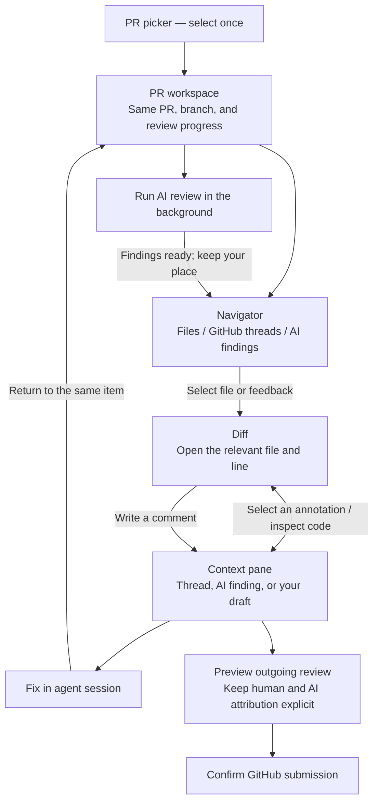

# PR review workflow proposal

Status: an experimental TUI implementation is available through **G / leader + G**.
The old PR Triage / Review workflow remains available through leader + U; W
continues to open the existing AI Review workflow. The standalone prototype below
remains useful as the original design sketch.

## Try the integrated experimental workflow

Run `cargo run --locked --bin amf` from this worktree. From the dashboard or a
session, press the leader key (normally `Ctrl+Space`), then uppercase `G`
(or press `G` directly from the dashboard).
Choose a PR once, then use `1` / `2` / `3` for Files, Threads, and AI findings.
`Tab` changes pane focus, `z` expands the focused pane, and `?` lists controls.

The integrated version uses real PR revisions, GitHub comments, durable human
drafts, AI review workers, and existing fix/confirmation flows. Human review
posting (`p`) and AI posting (`W` in AI) remain separate and explicitly
confirmed. `F5` reopens the same PR at its latest head. Editors and confirmation
dialogs use the existing full-screen presentation and return to the workspace.
After a successful human review submission, the existing review engine returns
to the PR picker.

## Try the interactive prototype

A standalone native TUI prototype is available in [examples/pr_review_workspace.rs](../../examples/pr_review_workspace.rs). Run it from the repository root:

```bash
cargo run --locked --example pr_review_workspace
```

Start with a terminal at least 125 columns wide to see all three panes. Resize it to try the navigator drawer (85–124 columns) and the single-pane layout (below 85 columns).

Suggested walkthrough:

1. Press `j` / `k` to select a GitHub thread and see its diff and conversation together.
2. Press `1` for Files or `3` for AI findings. Each category remembers its selected item.
3. Use `Tab` / `Shift+Tab` to change pane focus. Use `j` / `k` to scroll the focused code or discussion, and `z` to expand or restore that pane.
4. Press `c` to write a draft for the current file, then `Ctrl+S` to save it in memory. `Esc` cancels editing.
5. Press `a` to simulate a background AI pass; continue browsing while it runs. Completion updates the status without changing your place.
6. Press `s` to toggle a thread's demo resolution or an AI finding's kept/skipped status. Press `r` to mark the current file as read.
7. Press `f` to visit a simulated fix session, then `Enter` to return to the same item.
8. Press `p` to preview human drafts and kept AI findings. Scroll overlays with `j` / `k` or the arrow keys.
9. Press `?` for help or `q` to quit.

The prototype uses fictional data and in-memory state. AI runs, fixes, and thread resolution are simulations; submission is a preview. Drafts are simple append-and-backspace file comments, rather than a complete inline editor. It does not connect to GitHub, launch agents, or change AMF's existing workflow. All prototype state is discarded on exit.

## The problem

PR Triage, AI Review, and manual PR Review feel like separate tools. Triage opens AI Review as a separate screen with a return path, while manual review lives behind a different tab in the PR picker. Moving between these activities requires repeated exits and PR selection.

## Recommended direction: a split PR workspace

Make **the PR the place you stay**, with the code and its feedback visible together. Select the PR once. Reading code, triaging comments, and assessing AI findings all happen within the same workspace.

The original idea was three switchable views. A stronger redesign would make the diff the main surface, with a switchable navigator on the left and feedback details on the right. This lets you evaluate a comment against the actual code without repeatedly changing screens.



The panes are parts of one screen, not steps that must be completed in order. Submission is an explicit action; navigating or generating findings never posts anything.

## TUI layout sketch

```text
 PR #482 · Improve session recovery · feature/recovery · head a1b2c3
 6 open threads · AI: 4 findings · 2 draft comments · 3/12 files read
 ────────────────────┬──────────────────────────┬──────────────────────
 Files Threads [AI]  │ src/recovery.rs          │ AI · Unpublished
                     │                          │ Possible stale handle
 > Stale handle      │  40  fn recover() {      │
   Retry loop        │ -41    old_handle()      │ This call can reuse a
   Missing cleanup   │ +41    cached_handle()   │ handle after restart…
   Error context     │  42  }                   │
                     │                          │ Keep · Skip · Edit
                     │                          │ Investigate · Fix
 ────────────────────┴──────────────────────────┴──────────────────────
 Focus pane · Expand pane · Run AI review · Preview submission · Help
```

The labels and counts are illustrative. Exact keybindings would need to fit the existing controls and pane focus behavior.

### What each pane does

| Pane | Purpose | Behavior |
|---|---|---|
| Navigator | Choose files, GitHub threads, or AI findings | Switching the list preserves selection in each category. Selecting a feedback item opens its location and details together. |
| Diff | Read code and write inline comments | Show markers for feedback and drafts. Selecting a marker opens its details; multiple items on one line offer a small chooser. |
| Context | Read or act on the selected feedback | Show the complete thread, finding, or draft, with actions appropriate to that item. Allow expansion for long discussions or editing. |

Keep GitHub threads and AI findings as separate navigator categories initially. Their source, publication state, and available actions differ. A combined filter can be added later if it proves useful.

### Fit the terminal

A permanent three-column layout would be cramped in many terminals. Use the available width:

- **Wide:** navigator, diff, and context visible together.
- **Medium:** diff and context side by side; open the navigator as a drawer.
- **Narrow:** one pane at a time, with a persistent PR header and direct switching among navigator, code, and context.

Allow any pane to expand temporarily. Preserve focus, selections, and scroll positions when resizing. Choose width thresholds after trying realistic code and long comments; the sketch is not a fixed sizing specification.

## Example workflows

### Respond to existing feedback

1. Open the PR and select Threads in the navigator.
2. Select a thread. Its code appears in the diff and its conversation appears beside it.
3. Investigate, reply, resolve, or send a fix to an agent from the context pane.
4. Return from the agent to that same thread and code location.
5. Move to the next open thread without leaving the workspace.

### Review the PR yourself, with AI assistance

1. Select Files and read the diff. Mark files as read and write draft comments inline.
2. Start AI Review from the workspace and continue reading while it runs.
3. When findings are ready, select AI in the navigator. Completion does not move your cursor or change your current file.
4. Inspect each finding beside its code, then keep, edit, skip, or request a fix.
5. Open the submission preview to inspect outgoing comments and choose the review action.

The preview must distinguish your drafts from AI findings and show what each submission will post. Whether they become separate GitHub reviews or explicitly attributed items in a combined review remains a design decision. Posting existing threads' replies or resolving them stays a separate, explicit action.

## Behaviors that improve the flow

- **Pick the PR once.** Switching to manual review never sends you through the picker again. “Change PR” is an explicit action.
- **Keep your position in each pane.** Return to the same thread, AI finding, file, and scroll position. Preserve draft comments and marked items.
- **Connect feedback directly to code.** From a thread or AI finding, open its file and line in Changes. A return action takes you back to that exact item.
- **Let AI work while you review.** Start a pass, read the diff, and see a completion badge when findings are ready.
- **Keep agent fixes connected.** After visiting the fix session, return to the selected feedback item. If the PR head changes, show which review results need refreshing.
- **Keep posting explicit.** Human draft comments, unpublished AI findings, and existing GitHub threads retain clear identities and submission actions.
- **Handle feedback without a current code location.** General comments show PR context. Outdated threads and findings show their original revision when available, with a clear label and an explicit jump to the current file.
- **Avoid surprise navigation.** Background results update counts and badges. Only an explicit selection moves the diff. After jumping from feedback into code, provide a return action that restores the previous reading position.
- **Preserve work across PR updates.** Label AI findings with the reviewed head. When new commits arrive, retain drafts and reading progress, flag affected locations for rechecking, and offer refresh or rerun actions.

## Alternative directions

| Idea | What it feels like | Tradeoff |
|---|---|---|
| Minimal navigation repair | Add direct switches among the three existing screens, preserving the current PR | Fastest improvement; still feels like separate tools |
| Three views in one workspace | Comments, AI Review, and Changes share a header and PR context | Fits smaller terminals easily; feedback and code still require view switches |
| Unified review inbox | One feedback list with filters for GitHub threads, AI findings, and your drafts, alongside the diff | Convenient for processing everything; easier to confuse sources and statuses |
| Split workspace — recommended | Select feedback and see its code and details together | Stronger connection between feedback and code; requires careful sizing and focus behavior |

## Suggested first implementation slice

Start with a split workspace that connects existing feedback to the diff. The code already keeps AI findings separate from GitHub comments for good reasons; shared navigation can preserve that separation while removing repeated exits and PR selection. A shared presentation does not require converting AI findings into synthetic GitHub comments.

1. Introduce one PR entry point, shared PR context, and a diff with a feedback context pane. Make Files and Threads reachable without reopening the picker.
2. Add the AI navigator category using the same selection-to-code interaction, with background progress visible throughout the workspace.
3. Preserve positions, drafts, and agent return paths; support expandable panes and smaller terminals.
4. Add the outgoing review preview, keeping attribution and submission actions explicit.
5. Handle changes to the PR head, outdated locations, and findings that need a fresh AI pass.

Before calling the redesign complete, verify the full path from PR selection through manual review, AI review, agent fixes, and submission, including resizing and a PR that receives new commits during review.

## Decisions to settle with a prototype

- How much terminal width makes three columns comfortable, and which pane should collapse first?
- Should opening a PR resume its last activity or always start in Files? Proposed default: resume when possible, Files for a first visit, and preserve direct triage/AI entry shortcuts.
- Which existing keybindings can remain local to the focused pane, and how should global workspace actions be exposed?
- Should human and AI review submissions remain separate? The preview must make authorship and exactly what will be posted clear either way.

The main tradeoff is code width: a split view improves context, but it must be easy to expand the diff or the discussion whenever either needs more space.
