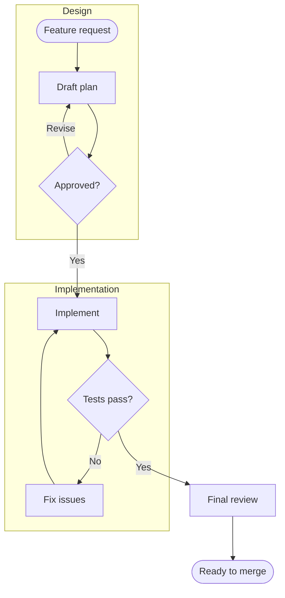

# Feature delivery: decisions and retries

Two grouped phases, decision diamonds, labelled branches, retry loops and a
shared path to delivery. Scroll vertically to follow the whole flow; press
`d` to inspect the Mermaid source.
