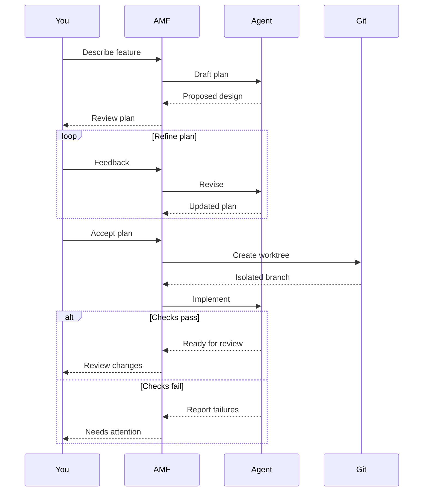

# Plan to implementation: four participants

Four participants, requests and replies, a refinement loop and alternate
success/failure paths. Press `d` to inspect the source. This is an illustrative
workflow; real AMF sessions can take other paths.
