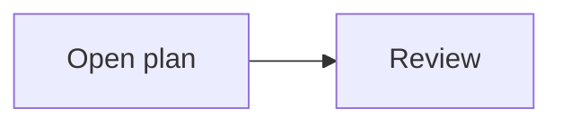
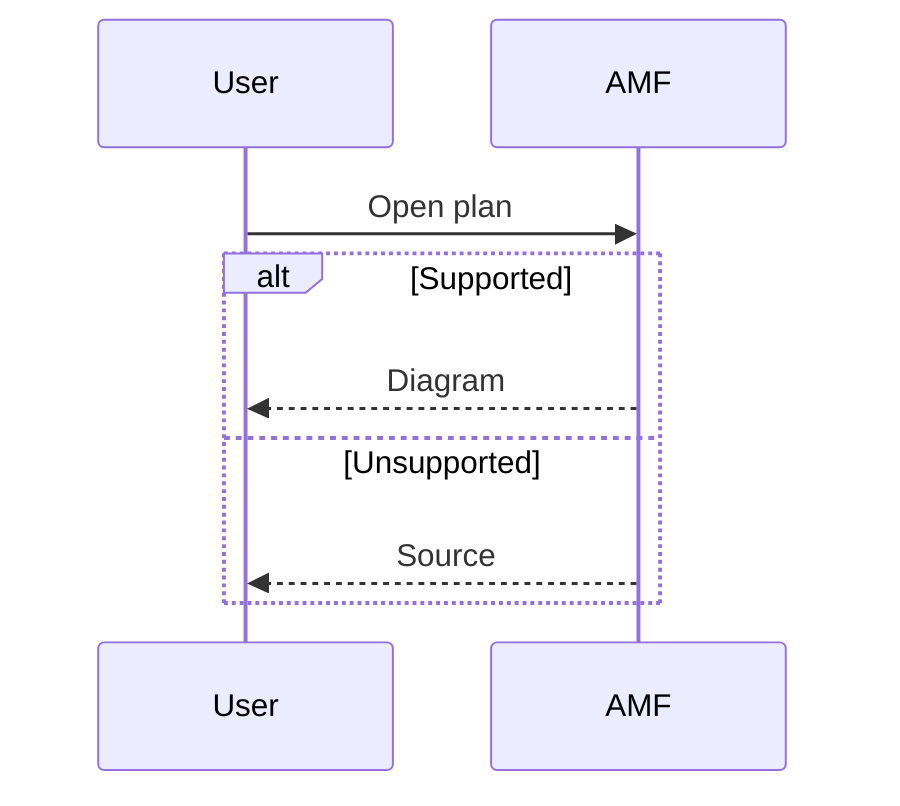

# Mermaid MVP: try it in AMF

Press `d` to switch between the diagram above and its source. If you see a
plain code block with no `d` hint, open this file in the MVP build's terminal
Markdown viewer using the steps below.

For richer examples, open `mermaid-advanced-flowchart.md` or
`mermaid-advanced-sequence.md` in the same file picker. They show grouped phases,
decisions, retries and a four-participant conversation.

AMF's terminal Markdown viewer and plan interview review render fenced
`mermaid` blocks as text diagrams. Basic flowcharts and sequence diagrams work
offline, without Node, a browser or terminal image protocols.

## Try the examples

1. Start this checkout with `cargo run --locked`.
2. While viewing a feature session for this worktree, use leader + `m` to open
   Markdown. If a document opens, press `/` to reach its file picker. If the picker is
   filtering to plans, press `p` to show all Markdown files. Press `/` to search
   for `mermaid-mvp` and open this document.
3. Scroll to the examples below. Press `d` to switch between diagrams and their
   original source. Press `r` to reload a file after editing it.

You can also put these blocks in the feature's current plan and open it with
leader + `n`. Plan interview review supports the same `d` toggle; `e` still
opens the original Markdown for editing. Source is preserved when saving or
accepting a plan. Use the leader configured in your workspace.

## Sequence

## MVP boundaries

This is a terminal interpretation of Mermaid. Shapes, line styles and layout
can differ from Mermaid's browser rendering. There is no diagram editing UI;
edit the fenced source in the document or plan editor.

Only `flowchart` / `graph` and `sequenceDiagram` are enabled. Ordinary code
blocks keep their existing behavior. Learning, review explanations, desktop
panes and live agent output are outside this MVP.

Invalid syntax, unsupported constructs, missing labels and charts wider than
the content pane display an explanation followed by the source. Widening the
terminal retries for the new width. In particular, sequence notes, activation
bars, participant boxes, autonumbering, advanced arrow types, configuration
directives, HTML/multiline labels and wide or combining characters use source
fallback. Flowchart links, callbacks, icons and images also use source fallback.

Work runs on one background thread, with at most one queued document. Results
are cached for the current source and width; closing, refreshing, resizing or
changing the source cancels obsolete work. Cancellation is checked between
rendering stages, rather than interrupting a layout already in progress.

Limits keep the experiment small: 16 diagrams per document; 16 KiB and 256
lines per diagram; 32 flowchart nodes, 64 edges and 8 groups; 8 sequence
participants and 64 events; 120 characters per label; 32,768 canvas cells.
Long flowchart edges are also bounded. Exceeding a limit retains the source.

The implementation uses pinned `selkie-rs` 0.3.0 with default features disabled.
See the [investigation and staged plan](backlog/mermaid-support-plan.md) for
the renderer evaluation and deferred work.
