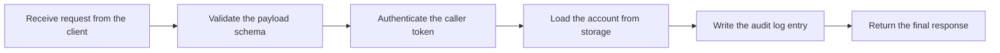
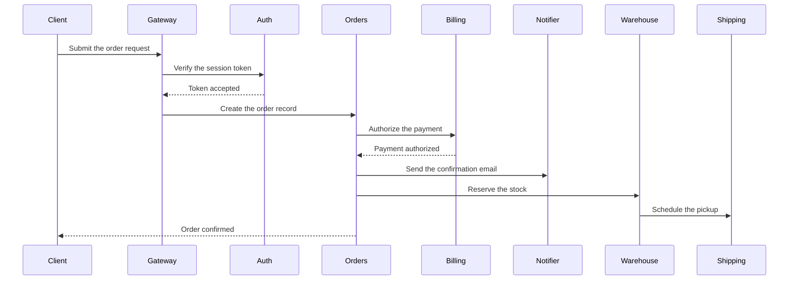
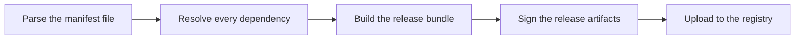
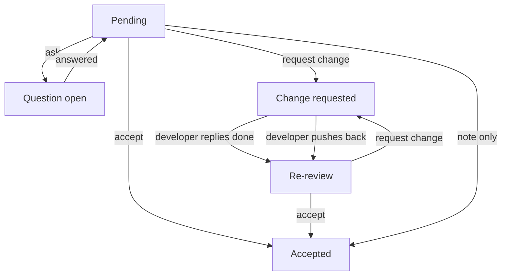
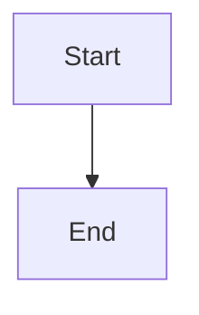

# Wide Mermaid diagrams

Open this file in the Markdown viewer on a narrow terminal (80 columns is a good
test). Each diagram below is wider than the viewer pane, from 164 to 222 columns
wide. On a wide terminal some of them can still fit; make the window narrower, or
press `f` off, to clip them all.

## What to try

1. Pan with `h`/`l` or Left/Right. Shift or Ctrl moves 16 columns instead of 4.
2. Look for `◂`/`▸` on clipped rows and `cols a-b of N` in the footer.
3. Press `f` to use the whole terminal, then resize the window while panned.
4. With the diagrams below, check that they all move together and that the
   shorter ones stop at their own right edge.
5. Press `d` to see the source, then `d` again; the pan resets.

This paragraph is wrapped normally and must not move while you pan.

## Flowchart



## Sequence



## Several wide diagrams

The pan offset is shared. This flowchart is wider than the viewer but narrower
than the two above, so when you pan to the far end it should stop and show its
last columns while the others keep moving.



This one is inside a blockquote, so its pane is two columns narrower. The
footer range follows the last diagram drawn, so its end column may be off by a
couple of columns here.

> ```mermaid
> flowchart LR
>     A[Fetch the latest changes] --> B[Rebase onto the main branch]
>     B --> C[Run the full test suite]
>     C --> D[Publish the build output]
>     D --> E[Notify the release channel]
>     E --> F[Archive the build logs]
> ```

## Edges that share a spot

Several edges below run between the same two nodes, so their labels would be
drawn on top of each other. Every label must be readable, stacked on its own
row beside the edge, and there must be no `Not shown:` list under the diagram.
"accept" and "request change" each appear twice; "developer replies done" and
"developer pushes back" must both be whole.



A label with quotes must be drawn as written, also with no `Not shown:` list.


## Narrow control

This one fits, so it must render exactly as before with no markers.


