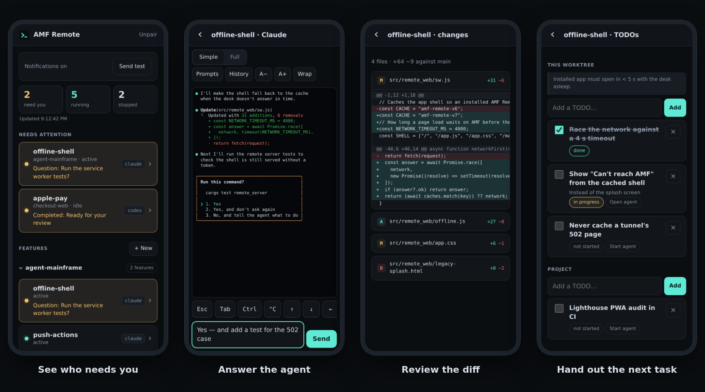
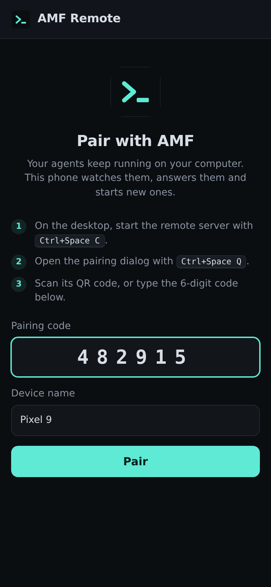
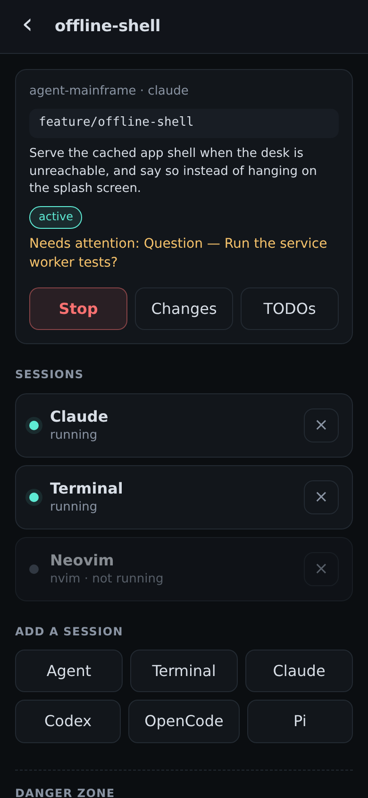
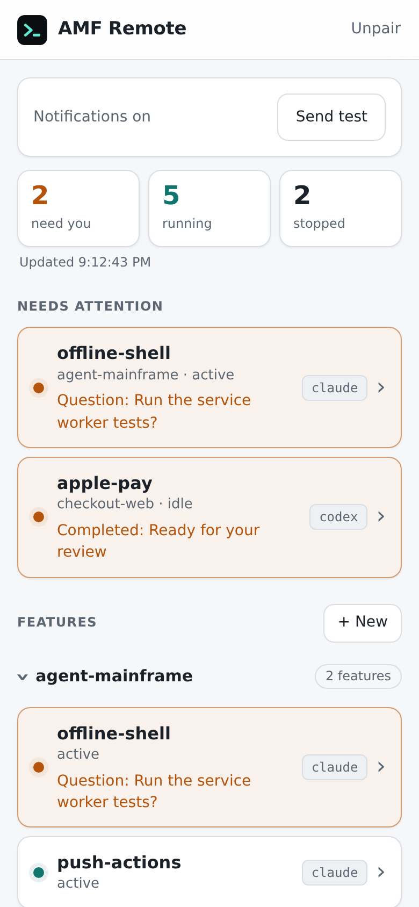

# AMF Remote

Agents stop to ask questions. AMF Remote lets you answer them from your phone
while they keep running on your computer. It's a Progressive Web App that the
`amf` binary serves itself: scan a QR code, add it to your home screen, and
you get a notification when an agent needs you.



Setup (Tailscale HTTPS, pairing, notifications, security) is in the
[AMF Remote guide](../../docs/remote-control.md). In short: `Ctrl+Space C`
starts the server and `Ctrl+Space Q` shows the pairing QR code.

## What it does

- **Triage at a glance.** Features waiting on you are pinned to the top, with
  the agent's question. Tap one to open that agent's session.
- **Answer in the real terminal.** A readable Simple view with quick keys
  (Esc, Tab, arrows, Ctrl, 1/2/3, y/n) and a reply box, or a Full xterm.js
  terminal. The phone and the desk share the same tmux session.
- **Review and steer.** Read a feature's diff against its base branch, manage
  worktree/project/global TODOs, start an agent on a TODO, and insert prompts
  from your library.
- **Run the fleet.** Create, start, stop and delete features, and add or
  remove sessions.

| Pairing | Feature | Light mode |
| --- | --- | --- |
|  |  |  |

## Under the hood

| | |
| --- | --- |
| **Installable** | Web app manifest with `any` and full-bleed `maskable` icons, standalone display, and light/dark `theme-color`. |
| **Starts offline** | A network-first service worker gives AMF 4 s, then opens the cached shell, which says "Can't reach AMF" instead of hanging on the splash screen. It never caches API responses or a tunnel's error page. |
| **Push** | Web Push signed with AMF's own VAPID key and end-to-end encrypted to the device. No Firebase project or relay. |
| **Always in sync** | HTML, CSS and JS are compiled into the `amf` binary, so the phone always runs the client that matches the server. |
| **Secure by default** | Pairing uses a one-time QR code that expires after five minutes. Each device gets its own token, stored only as a hash and revocable from the desk. Terminal WebSockets authenticate in their first message, so tokens never appear in URLs. HTTPS comes from Tailscale. |
| **No build step** | Plain HTML, CSS and JavaScript. xterm.js loads only when you first open the Full terminal, pinned with Subresource Integrity. |

## Files

| File | Role |
| --- | --- |
| `index.html` | The app shell: every view, hidden until routed to. |
| `app.js` | Hash routing, `/status` polling, actions, the terminal socket, ANSI rendering, push. |
| `app.css` | Styles. The palette matches agentmainframe.dev, in light and dark. |
| `sw.js` | Service worker: network-first shell cache and push notifications. Bump `CACHE` when the shell's file list changes. |
| `manifest.webmanifest`, `icon-*.png` | Install metadata and icons. |

The server side is `src/remote_server.rs` (HTTP routes and the embedded
asset table), `src/remote_terminal.rs` (terminal frames over WebSocket) and
`src/remote_push.rs` (Web Push). A new file here also needs a `WEB_ASSETS`
entry in `remote_server.rs`, and an entry in `SHELL` in `sw.js` if it should
work offline.

## Screenshots

The images above come from the real files in this folder, loaded in headless
Chromium at phone size, with every request answered from sample data. No AMF
process, tmux session or agent is needed:

```sh
node scripts/dev/screenshot/capture-remote-showcase.cjs <output-dir>
```

Copy the PNGs to `docs/screenshots/remote-app/`, and `showcase.png`,
`01-pairing.png` and `03-feature.png` to `site/static/images/remote/`. Set `AMF_PWA_BROWSER` to use a Chromium you
already have.
